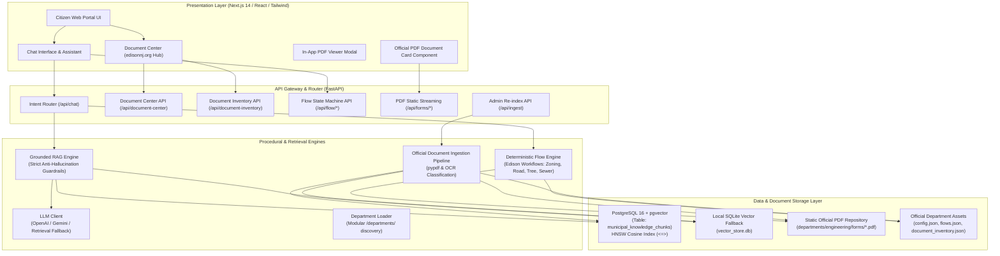
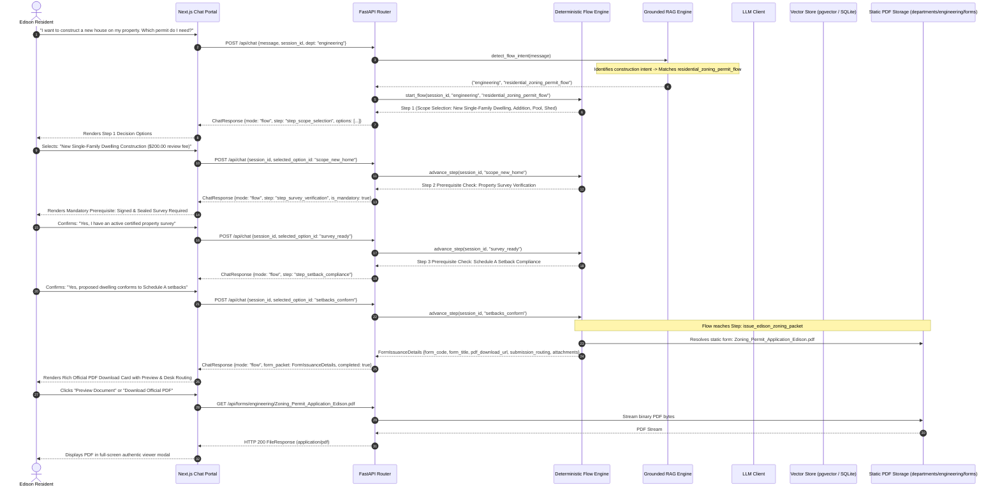
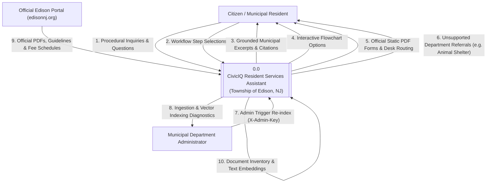
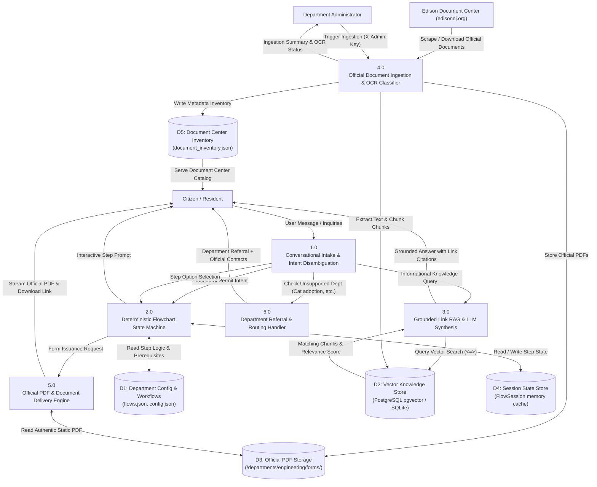

# CivicIQ - Edison Township Resident Services Assistant
## Comprehensive Architecture, Workflows & Data Flow Diagrams (DFD)

This document provides complete technical architectural specifications, end-to-end workflows, and Level 0 & Level 1 Data Flow Diagrams (DFD) for the **CivicIQ Resident Services Assistant** for the **Township of Edison, New Jersey**.

Official municipal source: `https://www.edisonnj.org/document_center/index.php`

---

## 1. High-Level System Architecture

The system operates across four distinct operational layers:
1. **Presentation Layer (Frontend)**: Next.js (App Router), React, Tailwind CSS, Lucide icons. Features dual interaction modes: conversational procedural chat with official PDF cards and a dynamic Document Center tab powered by the live inventory.
2. **API & Service Layer (Backend)**: FastAPI (Python), housing the Intent Disambiguation Router, Deterministic Flowchart State Machine, Grounded Link RAG Engine, LLM Client (OpenAI / Gemini / Retrieval-Only Fallback), and Department Registry Loader.
3. **Official Document Ingestion & Inventory Pipeline**: Ingests official documents from Edison Township Document Center (`edisonnj.org`), extracts text using `pypdf`, classifies scanned image PDFs (`scanned_pdf_needs_ocr`), and generates `document_inventory.json`.
4. **Vector & Relational Storage Layer**: PostgreSQL with `pgvector` extension storing 128-dimensional dense vector embeddings with HNSW cosine distance indexing (`<=>`), alongside local resilient fallback caching (`vector_store.db`).
5. **File & Asset Layer**: Modular departmental file organization (`/departments/<dept>/`) holding metadata (`config.json`), verified decision trees (`flows.json`), knowledge links (`knowledge_links.json`), inventory (`document_inventory.json`), and official downloaded PDF documents (`forms/`).

---

## 2. End-to-End Procedural Sequence Flow

The following sequence diagram details the full lifecycle of a resident inquiry—from procedural intent detection through mandatory prerequisite validation and authentic Edison PDF form issuance:

---

## 3. Data Flow Diagram: Level 0 (Context Diagram)

The Level 0 Context Diagram establishes the system boundary of the **CivicIQ Resident Services Assistant** and details all inbound and outbound data flows with external entities:

---

## 4. Data Flow Diagram: Level 1 (Subsystem Decomposition)

The Level 1 DFD decomposes the system into its core functional processes, data stores, and interactions:

---

## 5. Scope: Edison Township Department of Engineering

| Department | Status | Municipal Office | Contacts | Key Forms / Services |
|---|---|---|---|---|
| **Department of Engineering** | **Active Focus** | Municipal Complex, 100 Municipal Blvd | (732) 248-7288 / `engineering@edisonnj.gov` | Road Openings, Street Excavations, Utility Trenching, Tree Clearances, Sewer Connections, Municipal Site Plans |
