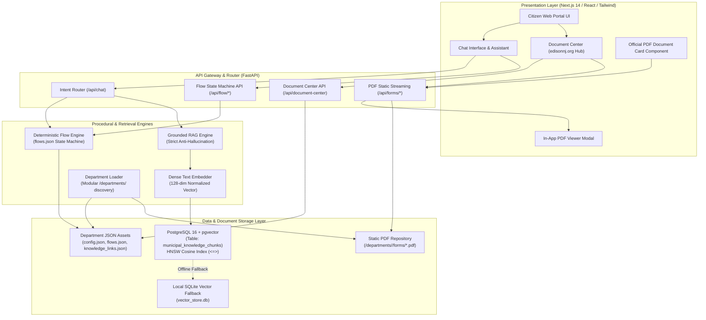
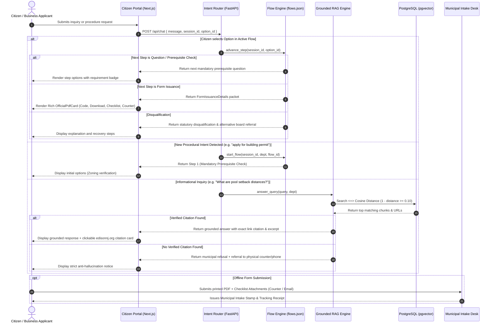
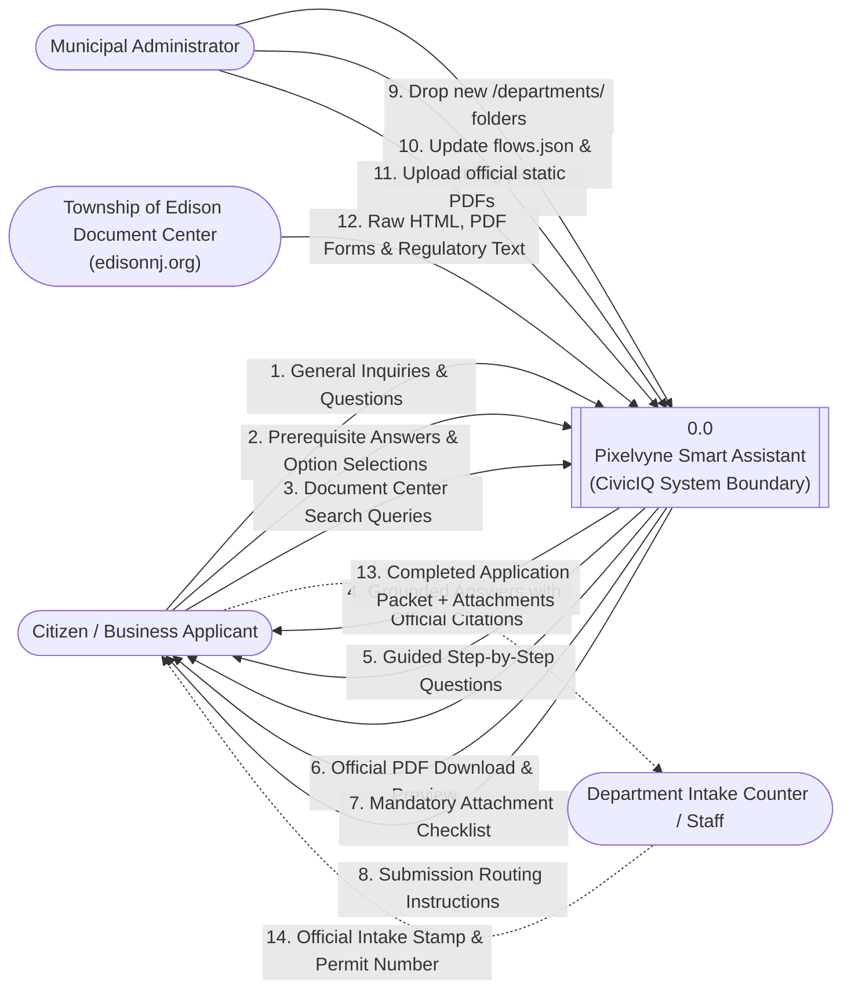
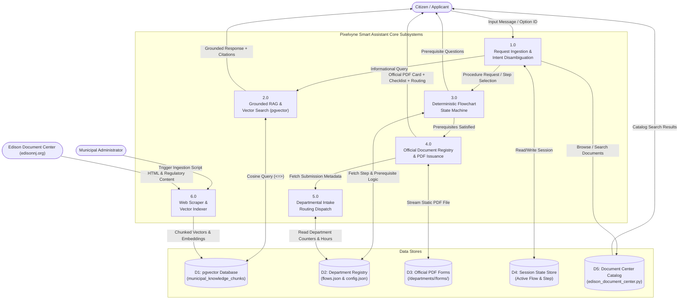

# CivicIQ - Pixelvyne Smart Assistant
## Comprehensive Architecture, Workflows & Data Flow Diagrams (DFD)

This document provides complete technical architectural specifications, end-to-end workflows, and Level 0 & Level 1 Data Flow Diagrams (DFD) for the **Pixelvyne Smart Assistant** (Citizen-Facing Procedural Web Portal).

---

## 1. High-Level System Architecture

The system operates across four distinct operational layers:
1. **Presentation Layer (Frontend)**: Next.js (App Router), React, Tailwind CSS, Lucide icons. Features dual interaction modes: conversational procedural chat and a full-text searchable Document Center tab.
2. **API & Engine Layer (Backend)**: FastAPI (Python), housing the Intent Disambiguation Router, Deterministic Flowchart State Machine, Grounded Link RAG Engine, and Department Registry Loader.
3. **Vector & Relational Storage Layer**: PostgreSQL with `pgvector` extension storing 128-dimensional dense vector embeddings with HNSW cosine distance indexing (`<=>`), alongside local fallback caching.
4. **File & Document Asset Layer**: Modular departmental file organization (`/departments/<dept>/`) holding metadata (`config.json`), decision trees (`flows.json`), knowledge links (`knowledge_links.json`), and official static PDF documents (`forms/`).

---

## 2. End-to-End Workflow & Decision Logic

The conversational agent strictly enforces municipal rules:
- **Informational Queries**: Routed to the Grounded RAG Engine. If vector distance is within threshold, returns answer with exact source citations (e.g. `edisonnj.org`). If unverified, strictly refuses to prevent hallucinations.
- **Procedural Requests**: Initiates the deterministic step-by-step decision tree (`flows.json`). Mandatory prerequisites (e.g., zoning classification, deed ownership, 811 Call-Before-You-Dig locate ticket) cannot be skipped.
- **Form Stage**: Issues the official, pre-existing static government PDF (e.g. `ENG-204`, `RoadOpenApp.pdf`, `Zoning ApplicationNEW.pdf`) with in-chat interactive checklist and intake routing.

---

## 3. Data Flow Diagram (DFD) Level 0: Context Diagram

The Level 0 Context Diagram establishes the system boundary of the **Pixelvyne Smart Assistant (CivicIQ)** and details all inbound and outbound data flows with external entities:
- **Citizen / Applicant**: Submits inquiries, completes guided prerequisite steps, downloads official PDF forms, and checks attachment lists.
- **Department Intake Counter / Staff**: Receives assembled application packets, provides intake stamps, and updates office hours.
- **External Municipal Document Center (`edisonnj.org`)**: Live external documentation repository scraped and ingested into vector embeddings.
- **Municipal Administrator**: Updates department configurations (`config.json`), flowchart decision trees (`flows.json`), and static PDF files (`/forms/`).

---

## 4. Data Flow Diagram (DFD) Level 1: Subsystem Decomposition

The Level 1 DFD decomposes the system into six core operational processes, four primary data stores, and internal data flows.

### Processes:
- **1.0 Request Ingestion & Intent Disambiguation**: Receives citizen input, parses session state, and routes to Flow Engine, RAG Engine, or Document Center API.
- **2.0 Grounded RAG & Semantic Vector Search**: Embeds query, executes vector cosine search (`<=>`) in pgvector, validates relevance threshold, and formats citations.
- **3.0 Deterministic Flowchart State Machine**: Traverses decision trees from `flows.json`, enforces prerequisite validation, handles branching, and tracks step history.
- **4.0 Official Document Registry & PDF Delivery**: Retrieves static official PDF files from disk, generates download URLs, formats checklist, and supplies fill-in guidance.
- **5.0 Departmental Intake Routing Dispatch**: Attaches exact physical counter location, building address, hours, cutoff times, and direct email dispatch (e.g. `clerk@edisonnj.gov`).
- **6.0 Web Scraper & Vector Indexer**: Scrapes URLs from `knowledge_links.json`, chunks text into overlapping segments, computes embeddings, and stores in PostgreSQL `pgvector`.

### Data Stores:
- **D1: PostgreSQL `pgvector` Store**: Table `municipal_knowledge_chunks` holding 128-dim embeddings, text chunks, and URLs.
- **D2: Department Registry & Decision Trees**: Modular `/departments/<dept>/` holding `config.json` and `flows.json`.
- **D3: Static Official PDF Forms Store**: `/departments/<dept>/forms/*.pdf` containing authentic government forms.
- **D4: Citizen Session State Store**: In-memory and browser session tracking active flow ID, step progress, and history.
- **D5: Edison NJ Document Center Catalog**: Structured metadata for 80+ documents from `edisonnj.org/document_center/index.php`.

---

## 5. Security, Anti-Hallucination & Compliance Policies

1. **Zero AI Form Generation**: The system never uses an LLM to generate, synthesize, or alter municipal application forms. It serves the exact, static, authorized government PDF files directly from the departmental repository.
2. **Strict Grounded Inquiries**: The RAG engine compares cosine similarity against `pgvector` stored chunks. Any query falling below the strict threshold ($0.10$) triggers a graceful refusal and redirects the citizen to the physical counter desk or official telephone dispatch.
3. **Deterministic Prerequisite Gatekeeping**: Mandatory checks (e.g. single-family residential zoning, deed ownership standing, 811 utility locate ticket) are non-bypassable code paths. If a citizen cannot satisfy a prerequisite, the flow redirects them to the appropriate appeal board (e.g. Zoning Board of Adjustment for setback variances).
4. **Local Resilience**: In environments without a live PostgreSQL server, the unified vector store automatically transitions to local SQLite vector caching so testing and local development operate without disruption.
